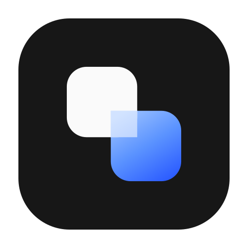
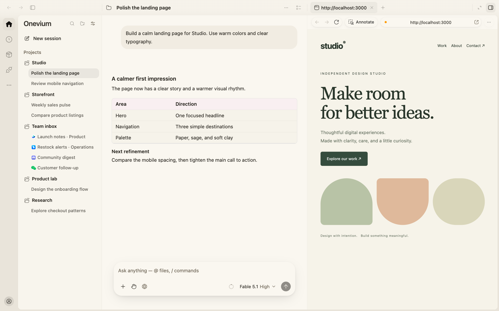
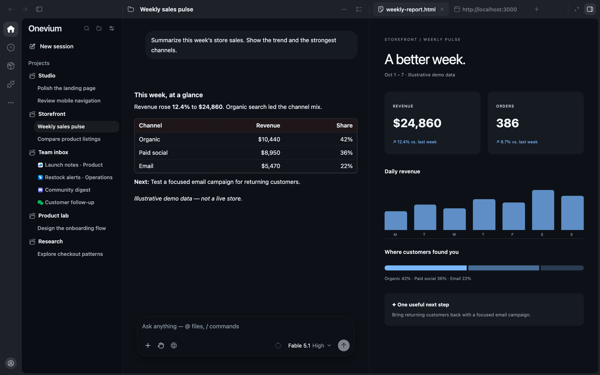
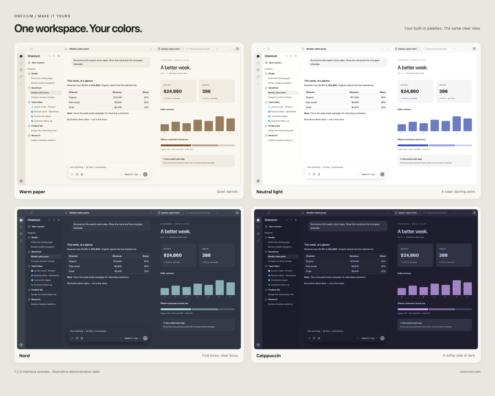

<div align="center">

**简体中文** · [English](README.en.md) · [日本語](README.ja.md) · [한국어](README.ko.md)



# Onevium

### 本地优先，把 AI 接入你的工作。

**Local-first · 本地优先**的桌面 AI 工作台。把多模型、浏览器、文件与业务工具组织在同一项目中，写代码、查资料、做图片，边执行，边检查成果。

**[下载 Onevium](https://github.com/Onevium/Onevium/releases/latest)** · [开始使用](https://onevium.com/zh/docs/getting-started) · [最新变化](releases/1.3.2.zh-CN.md)

macOS（Apple Silicon 与 Intel）· Windows x64

关注 **[@Onevium](https://github.com/Onevium)**，了解产品更新和实际 AI 工作流。

</div>



*截图来自 1.3.0 开发阶段的隔离演示，使用真实界面组件；项目、对话和报表均为模拟数据。*

## 从个人项目，到企业日常

Onevium 已在**客服、物流、跨境广告等行业的企业**中使用。把已有的模型服务、账号和业务工具连接起来，组合适合自己团队的工作流。

## 支持你选择的模型与服务

| 类型 | 支持的连接 |
| --- | --- |
| 国际模型服务 | Claude / Claude Code、OpenAI GPT、Google Gemini、xAI Grok |
| 国内模型服务 | DeepSeek、智谱 GLM / z.ai、Kimi / Moonshot、MiniMax、阿里云千问 Qwen、小米 MiMo |
| 自定义服务 | 按兼容接口接入自定义服务或团队模型网关，配置自己的地址、密钥与模型 ID |
| 图片创作 | 单独连接 OpenAI 或 Google Gemini 图像服务 |

在同一会话中按任务切换模型，也可以为协作队伍的不同成员选择模型。可用型号、工具能力与费用以连接的服务和账户权限为准。Onevium 账号与授权独立于模型服务权限。 [查看连接说明](https://onevium.com/zh/docs/providers)。

**本地优先，服务自选。** 项目文件、会话与工作资料以本机工作环境为中心，凭据在本机加密保存。调用云端模型、图像服务或办公渠道时，相关内容会发送到你配置的服务。

## 从一件你想完成的事开始

| 你想做什么 | 在 Onevium 里怎么做 |
| --- | --- |
| **做一个网站，或修改现有项目** | 让 AI 编辑文件，在对话旁打开页面预览，再通过 Review 检查改动。想尝试另一种方案，也可以使用独立 Git 工作树。 |
| **研究一个主题，或整理一份报告** | 围绕任务使用网页和文件，核对资料，把摘要、图表和讨论留在一起。[试试示例](examples/README.md)。 |
| **创作一张图片，再继续修改** | 从描述、模板或参考图起步，圈选区域、添加批注，在图片旁继续调整。需要单独配置图片服务。 |

<details>
<summary><strong>看看报表示例和四种内置主题</strong></summary>



销售额、订单、渠道和结论均为模拟，不代表连接了真实店铺。[查看示例](examples/README.md)。



这些截图同样来自上文说明的 1.3.0 开发演示。

</details>

## 下载 Onevium

**当前稳定版：1.3.2。** [查看更新内容与升级须知](releases/1.3.2.zh-CN.md)。

| 系统 | 下载 |
| --- | --- |
| macOS · Apple Silicon | [下载 arm64 DMG](https://github.com/Onevium/Onevium/releases/download/v1.3.2/Onevium-1.3.2-arm64.dmg) |
| macOS · Intel | [下载 x64 DMG](https://github.com/Onevium/Onevium/releases/download/v1.3.2/Onevium-1.3.2-x64.dmg) |
| Windows · x64 | [下载 EXE](https://github.com/Onevium/Onevium/releases/download/v1.3.2/Onevium-Setup-1.3.2.exe) |

**准备升级到 1.3.2？** macOS 用户需要先退出 Onevium，再通过 DMG 手动安装本次更新。首次启动会升级本地数据，1.3.1 无法直接读取升级后的数据。更新前请阅读[升级、签名与恢复说明](https://onevium.com/zh/docs/installation#updates)。

当前稳定版没有 Linux 或 Windows arm64 安装包。安装后完成账号登录或授权激活，再连接可用的模型服务。[安装与系统兼容性](https://onevium.com/zh/docs/installation) · [企业与团队咨询](https://onevium.com/zh/pricing)。

## 快速安装

<details>
<summary><strong>展开 macOS 与 Windows 安装命令</strong></summary>

**macOS · Apple Silicon / Intel** — 打开终端，复制这一行：

```sh
curl -fsSL https://raw.githubusercontent.com/Onevium/Onevium/main/install/install.sh -o onevium-install.sh && sh onevium-install.sh
```

自动识别芯片，下载官方稳定版安装包，核对 SHA-256，然后打开安装界面。将 Onevium 拖入「应用程序」即可完成安装；更新前先退出正在运行的 Onevium。

**Windows x64** — 在 PowerShell 中运行：

```powershell
$p = Join-Path $env:TEMP 'onevium-install.ps1'; Invoke-WebRequest 'https://raw.githubusercontent.com/Onevium/Onevium/main/install/install.ps1' -OutFile $p -UseBasicParsing -ErrorAction Stop; & $p
```

下载脚本后按系统现有策略运行，校验安装包并打开安装向导。若策略不允许运行脚本，可直接下载安装包。

[查看脚本、指定版本与安装说明](install/README.md)。

</details>

## 可以自由组合的功能亮点

- **多模型接力与队伍协作**：在会话中切换模型，为不同成员分配模型与任务，把调研、执行和检查串成一条流程。
- **浏览器多身份 × 独立网络代理**：为不同账号保存独立 Cookie、登录状态与网络线路，支持 HTTP、HTTPS、SOCKS5，按任务选择合适的身份。
- **秘钥与主机管理**：在本机加密保存 API、数据库与 SSH 凭据，让 AI 按名称引用；使用过程遵循授权设置，并遮蔽输出中的已知秘钥。
- **SSH 远程工作**：连接服务器，让 AI 在授权范围内执行命令、读写文件，按一次、限时或会话管理权限。
- **多渠道接入办公与沟通软件**：连接飞书、钉钉、Discord 的群聊与私聊，以及微信私聊，让项目助手在已有沟通入口接收任务并返回结果。
- **Skills × MCP × 插件**：把团队流程整理为可复用技能，连接业务工具，再按项目和任务组合使用。
- **定时自动化与通知**：在 Onevium 运行期间安排周期任务，会话完成、需要确认或出错时接收通知。
- **可追溯记忆**：查看记忆的来源会话、依据与修改记录；回答使用记忆时可以追溯，不用只依赖一段越来越长的聊天记录。

**组合示例：** 从飞书接收任务 → 选择模型或组织队伍 → 用对应身份与代理访问业务页面 → 在授权范围内引用秘钥、处理文件 → 汇总结果并回复渠道。先接通任务需要的服务与权限，再把验证过的步骤沉淀为 Skill 或定时流程。

[浏览器与身份](https://onevium.com/zh/docs/browser-automation) · [队伍协作](https://onevium.com/zh/docs/teams) · [办公渠道](https://onevium.com/zh/docs/team-channels) · [秘钥与 SSH 更新](releases/1.3.1.zh-CN.md) · [记忆与网络线路更新](releases/1.3.2.zh-CN.md)

## 关注更新，试试工作流，也告诉我们你需要什么

**关注 [@Onevium](https://github.com/Onevium)**，了解新版本、工作流示例和可复用的 Agent Skills。如果 Onevium 对你有帮助，欢迎 **[Star 这个仓库](https://github.com/Onevium/Onevium)**，让更多人发现它。想接收版本通知，可以在本仓库选择 **Watch → Custom → Releases**。

| 继续探索 Onevium 的项目 | 入口 |
| --- | --- |
| 适用于 Claude Code、Codex 等工具的工作流 | [Agent Skills](https://github.com/Onevium/skills) |
| Onevium 应用内的插件与技能 | [Onevium Skill Community](https://github.com/Onevium/onevium-skill-community) |

遇到问题，或有想完成的工作流？欢迎[提交 Issue](https://github.com/Onevium/Onevium/issues)，或联系 support@onevium.com。

---

[官网](https://onevium.com/zh) · [使用文档](https://onevium.com/zh/docs) · [更新日志](CHANGELOG.md) · [全部版本](https://github.com/Onevium/Onevium/releases)

本仓库提供产品介绍、演示素材、公开安装辅助脚本与 Release 安装包，不包含应用源码。
